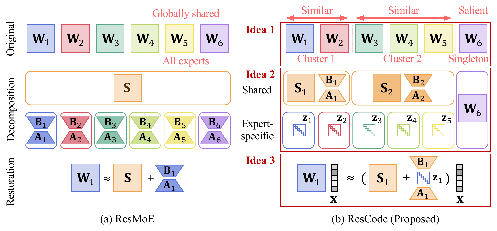

# ResCode: Accurate Expert Compression of Sparse MoE Models via Residual-code Restoration

This repository contains the implementation of **RESCODE**, an accurate expert compression method for sparse mixture-of-experts (SMoE) models.
RESCODE forms compact expert clusters, coalesces residuals into cluster-shared low-rank bases, and learns compact codes to accurately recover the original routed outputs.

## Overview

<p align="center">
  
</p>

Given a pretrained SMoE model, RESCODE compresses experts through three main ideas:
**(I1)** saliency-aware cluster-wise restoration,
**(I2)** diagonal residual-code coalescing, and
**(I3)** output-guided fitting.

## Prerequisites

We tested the code with the following environment.

- Python 3.10
- PyTorch 2.8
- HuggingFace Transformers 4.40
- NVIDIA GPU (we used a single B200 180GB GPU)

Install required packages:
```bash
pip install -r requirements.txt
```

## Setup

Download the pretrained SMoE models from HuggingFace (loaded automatically on first run):

- Mixtral-8x7B-v0.1 (`mistralai/Mixtral-8x7B-v0.1`)
- Qwen1.5-MoE-A2.7B-Chat (`Qwen/Qwen1.5-MoE-A2.7B-Chat`)
- DeepSeek-MoE-16B (`deepseek-ai/deepseek-moe-16b-base`)

Prepare a calibration corpus once via the HuggingFace `datasets` library
(DCLM is the default; SlimPajama, English Wikipedia, and StarCoder are also
supported):

```bash
python scripts/RESCODE/prepare_calib_datasets.py --dataset dclm
```

The `c4` option instead expects a pre-downloaded shard at
`rescode/data/c4-train.00000-of-01024.json`.

## Running

### Compress an SMoE model

Per-model launch scripts live under `scripts/RESCODE/` (see
[scripts/README.md](scripts/README.md) for the full table); each sets its
paper defaults and calls the shared launcher `scripts/RESCODE/run.sh`:

```bash
bash scripts/RESCODE/run_mixtral_4x.sh    # Mixtral-8x7B,  8 -> 4 experts  (50%)
bash scripts/RESCODE/run_qwen_30e.sh      # Qwen1.5-MoE,  60 -> 30 experts (50%)
bash scripts/RESCODE/run_dsmoe16b_32e.sh  # DeepSeek-MoE, 64 -> 32 experts (50%)
```

Main knobs (override via env vars; all documented inline in `run.sh`):
- `MODEL`: HuggingFace model name
- `GPU`: device id, or a comma-separated list (e.g. `0,1`) to split the model over several GPUs
  (Mixtral-8x7B on 80 GB cards)
- `NUM_EXPERTS`: nominal compressed expert (cluster) count per layer `C`
- `SALIENCY_TOP_TAU`: singleton ratio rho in % - the top-ceil(rho*N) experts of each layer by saliency stay singletons (default `15.0`)
- `CLUSTERING`: expert distance used to group the non-singleton experts (`dist`:
  `dist_out(i,j) = mean_x ||E_i(x) - E_j(x)||^2` over the whole calibration set, default for Qwen and
  DeepSeek; `descriptor`: distance between the mean expert outputs on `CLUSTER_N_SENTENCES` sequences as in
  HC-SMoE, default for Mixtral). Saliency `a_i` and routing frequency `omega_i` are accumulated in one pass
  over the whole calibration set in both cases
- `LINKAGE`: agglomerative linkage (default `average`)
- `BUDGET_AWARE`: count the residual bases/codes toward the expert-memory budget so that
  `|Theta_hat_E| <= tau|Theta_E|` holds exactly; extra merges are spread over layers, giving layer-specific `C_l` (default `True`)
- `RANK`: residual rank `r` (default `128`)
- `ALPHA`: residual scale (a re-parameterization of the codes `z_i`; the initialization does not depend on it)
- `TARGET`: projection branches to restore (default `gate_up_down`)
- `LAMBDA_MSE` / `LAMBDA_LM`: weights of `L_rec` and `L_LM` in Idea 3. The paper objective
  `L_rec + lambda L_LM` is `LAMBDA_MSE=1`, `LAMBDA_LM=lambda`; `LAMBDA_MSE=0` gives the LM term only
- `REC_MODE`: original-layer target of `L_rec` (`local` by default: the original layer evaluated on the
  compressed model's layer input, so `y_hat - y = sum pi_i (E_hat_i - E_i)` as in Sec. 4.4 and each layer fits its own
  residuals; `trajectory`: layer outputs of the original model on its own forward pass). Both keep frozen
  copies of only the merged experts, not a second model
- `JOINT_EPOCHS`: output-guided fitting epochs `n_ep` (default `3`); `TRAIN_BATCH` x `JOINT_GRAD_ACCUM`
  = sequences per optimizer step (default `1 x 8`)
- `CALIB_DATASET`: calibration corpus (`dclm` by default; `c4`, `slimpajama`, `wikipedia`, `starcoder`)
- `SEED` / `CALIB_SEED`: optimization and calibration-sampling seeds (defaults `0` / `42`); multi-seed runs vary both jointly
- `EVAL_LIMIT`: evaluate only the first N examples per task (quick checks; `0` = full benchmarks)

Every run appends the measured expert-memory compression ratio (residual parameters included) to
`results/<family>/<run>/result.txt`, and caches the calibration statistics under
`results/<family>/calib_stats/` so runs that share the calibration set reuse them.

Example:

```bash
GPU=0 NUM_EXPERTS=4 bash scripts/RESCODE/run_mixtral_4x.sh
```

### Evaluate

Every compression run ends with zero-shot evaluation on the eight benchmarks
(ARC-c/e, BoolQ, HellaSwag, MMLU, OpenBookQA, RTE, WinoGrande) via
`lm-evaluation-harness`; per-task accuracies and the average are appended to
`results/<family>/<run>/result.txt`. To re-evaluate a finished run without
re-fitting, reuse its saved residual state:

```bash
LOAD=auto bash scripts/RESCODE/run_mixtral_4x.sh
```

## Reference

Parts of this code are adapted from the following repositories:

- **HC-SMoE** (https://github.com/wazenmai/HC-SMoE): expert similarity-based hierarchical clustering procedure
- **ResMoE** (https://github.com/iDEA-iSAIL-Lab-UIUC/ResMoE): baseline residual restoration implementation for comparison
- **REAP** (https://github.com/CerebrasResearch/reap): routing-aware expert pruning baseline

We thank the authors for releasing their code.

## License

This repository is released under the MIT License (see [LICENSE](LICENSE)).
`rescode/models/mixtral/modeling_mixtral.py` is derived from HuggingFace
Transformers and retains its original Apache-2.0 license header.